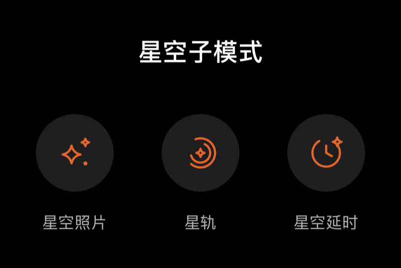

# 星空五项修复与子模式图标（2026-11-16）

## 实现

1. **自动 ISO 与 EV**：三个引擎统一在采集前测光，按 `ISO × 测光秒数 / 实际采集秒数 × 2^(用户EV − 测光offset − 原生bias)` 换算，并限制到当前格式ISO范围。测光使用15fps取景、自动曝光上限1/15秒；连续两次曝光乘积差小于0.06EV且设备未调整曝光，最早0.24秒采用读数；最多等1.5秒后使用最新读数继续拍摄。阈值是应用策略。整组曝光及白平衡锁定，等待系统自定义曝光完成回调后才开始接收采集帧。取消、新拍摄及退出使旧任务失效。取景/退出恢复自动曝光上限，不把临时测光限制带回普通相机。
2. **零帧停止**：准备阶段或第一帧前停止明确走取消，清理状态与恢复记录；异步准备、RAW回调、延迟下一帧用拍摄UUID隔离。
3. **焦距元数据**：RAW有实际焦距时写入EXIF `FocalLength`；35mm等效独立写入 `FocalLenIn35mmFilm`。视频供帧没有已知物理焦距时省略，取消13/24/100冒充物理毫米数的回退。实际ISO及曝光快照在恢复取景前记录。核对实际保存文件，非详情标签替换。
4. **星点配准**：多星点匹配估计旋转和平移，最少四个可信匹配；在原始CIImage上变换，星点检测用线性浮点缩略图，不再经过8位sRGB。保留半浮点融合缓存；无可靠星点时不虚构变换。
5. **后台保存与恢复**：新增 `AstroRecoveryJournal/Store/Panel`。图像原子写入文件后更新manifest，最多每5秒留一份采集中检查点，最终结果强制留存。视频直接写Application Support中的分段MOV，每个输出帧为关键帧，恢复采用passthrough重封装。保存及退后台收尾申请UIBackgroundTask，结束/过期配对释放；过期、保存失败留下文件，下次进入星空提供保存或丢弃入口。已知相册提交失败恢复为ready；提交中进程终止保留importing提示，避免把不确定状态写成保存失败。恢复弹窗沿用淡入淡出，跟随条目数量限高并可滚动，按钮保留点击热区。
6. **子模式图标**：星空照片为大小星光，星轨为绕星点长弧，延时为星光时钟；统一轻量细线矢量，展开22pt、收起26pt。按钮外框和胶囊触摸行为不变。

## 官方依据与应用策略

- [Apple自定义曝光](https://developer.apple.com/documentation/avfoundation/avcapturedevice/setexposuremodecustom(duration:iso:completionhandler:))说明duration/ISO锁定、曝光完成回调及RAW拍照需speed优先。测光换算、收敛阈值、整组锁定是应用实现，不是系统自动ISO的保证。
- [Apple曝光属性](https://developer.apple.com/documentation/avfoundation/capture-device-exposure)定义曝光offset、bias及调整状态。本机当前格式不支持固定快门原生autoISO，正式采集走测光换算后锁定，未把被跳过的原生能力测试计为通过。
- [Apple后台时间](https://developer.apple.com/documentation/uikit/extending-your-app-s-background-execution-time)明确后台时限有限且须平衡begin/end；本实现依靠落盘恢复补充有限后台时间。
- [Apple分段MOV](https://developer.apple.com/documentation/avfoundation/avassetwriter/moviefragmentinterval)支持中断后打开部分已写入片段；[首片段间隔](https://developer.apple.com/documentation/avfoundation/avassetwriter/initialmoviefragmentinterval)缩短首个可用片段等待。每输出帧分段是低频星空延时的应用取舍，未推广到普通高帧率视频。

## 真机验证

设备：iPhone 17 Pro（iPhone18,1），iOS27.2.1（24B156），UDID尾号0220401C。全部诊断不写系统相册。

- 真实后台交互：用户返回主屏约5秒再打开，实际AstroModeView生命周期完成星轨收尾。29帧结果为ready，实际HEIC可解码，新的恢复协调器能读取；界面恢复入口截图已检查。测试1/1通过，耗时45.824秒（含等待用户操作，非保存耗时）。证据 `/tmp/LumaAstroBackgroundR3-20261116.xcresult` 及同名log。
- 最终集成：29项执行，28通过、1跳过、0失败；跳过项为需用户配合的后台用例，已在上面的独立测试通过。执行用例累计106.495秒；证据 `/tmp/LumaAstroFinal-20261116.xcresult` 及同名log。
- 自动ISO：3轮各2帧RAW，目标快门0.5秒、EV+1。目标ISO为102.322/102.660/100.644，传感器完成回调读回102.305/102.698/100.753；实际保存文件均0.5秒、EXIF ISO100。文件ISO采用设备RAW报告的标称值（测试容差12%），同时独立检查传感器实际值误差1%，没有靠放宽文件容差代替硬件读回。包含测光阶段取消后立即重新拍摄。准备总耗时1.164/2.422/2.237秒（含测光和系统曝光完成回调）；其中2轮1.5秒测光等待到期仍继续拍摄，非无限等待收敛。
- 手动RAW文件：ISO400 + EV1得到ISO800、曝光1/15秒、物理焦距6.764999866mm、等效24mm。星轨8轮首帧前停止后，下一次采集仍成功；每轮180ms后检查无残留拍摄状态（实际观察间隔181—224ms，包含调度误差）。
- 延时真实采集：3帧2160×3840，保存后新的协调器读取0.1秒视频。中断片段测试在writer仍writing时拷贝文件，恢复0.633秒H.264，验证仍为H.264且采用passthrough。
- 取景回归：90次闲置参数刷新、93次采集中刷新、9次镜头切换、三个引擎完成/取消/暂停恢复均通过。13次启动/恢复的参数稳定0.712—2.067秒（20ms轮询设备读数，包含启动及恢复，不代表显示帧率）。
- 配准：11星点旋转/平移合成场景误差小于1.5像素，保留大于2的HDR值及0.12345线性背景精度；512px合成图12轮匹配耗时88.76—93.19ms，不代表全分辨率RAW吞吐。
- 恢复写入：1024×768图像4次完整编码/原子文件/manifest为7.15—12.47ms；后台过期留存、最新检查点冷加载及丢弃均通过。
- 真机界面：图标两种尺寸、四方向、选中/未选中16组快照绘制19.59—27.20ms；恢复弹窗1/6条、方向变化及重复挂载12组绘制31.05—59.00ms。截图已复查单条无大面积留白，多条可滚动。此为快照绘制成本，不是实际帧率。模式胶囊1000轮状态序列、36组布局及两侧挂载回调通过（回调注入，非OS触摸自动化）；原用户确认过的胶囊触摸实现未改。
- Release构建通过：`/tmp/LumaAstroReleaseR2-20261116.log`。第一次构建发现生产电影光圈接口被包含在DEBUG区域；仅将`setCinematicAperture`完整方法移到条件编译之外，函数体不变，第二次正式构建通过。Debug实测已调用相同方法体，本次没有额外改变电影拍摄算法。
- 已用devicectl退出测试进程并启动普通App，启动成功。

### 调试阶段记录

- 首次自动ISO文件校验将标称EXIF ISO与硬件浮点ISO按3%比较，108.63目标/100标称超出容差。最终增加系统完成回调后的传感器ISO和快门独立校验，并将文件标称ISO容差改为12%；上面的三轮真实采集同时通过两类核对。
- 后台脚本首轮复制xctestrun到/tmp后产品相对路径失效，改为绝对路径；第二轮在相机尚未ready时请求切模式被正常拦截，补充ready等待后第三轮真实后台测试通过。前两轮均未进入实际退后台保存，不计作后台产品失败或通过。

## 实测范围

- 实际采集与后台测试在室内完成；未进行真实星空、分钟/小时级温升与电量验证。
- 多星点刚体配准不包含镜头畸变校正、完整天球投影或光流；少于四个可信星点时保留原帧。验证包括合成星点和真实RAW采集链路，真实星野效果仍需外拍。
- 后台保护不是无限执行许可。进程被终止时依赖已完成的图像检查点/视频片段，尚未落盘的最后部分可能缺失。恢复测试的“冷加载”指新协调器读取磁盘，并非真实强杀/重启手机。
- 本轮没有向用户系统相册写诊断资源，因此没有将系统相册导入端到端写入计为通过；正式代码采用文件资源提交，已知失败保留重试入口。
- 统计中的快照绘制时间不是显示帧率；没有以测试进程内存表示App内存。

昨天的过程证据保留于 [暂停记录](2026-11-15-Astro-Five-Fixes-WIP.md)，本报告为最终状态入口。

## 界面证据

[单条恢复弹窗真机截图](Assets/2026-11-16-Astro/Recovery-Single.png)
