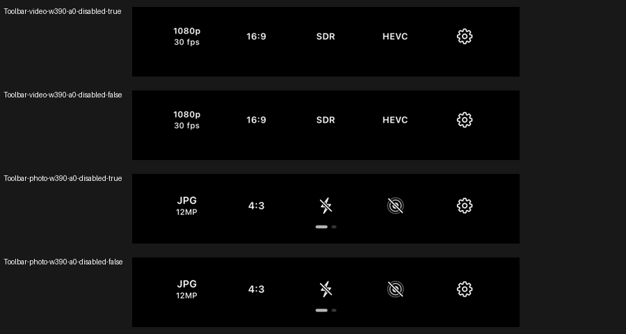

# 2026-11-18 顶部工具栏默认与禁用文字统一白色

## 当前行为

拍照、视频、星空顶部工具栏的默认文字、图标、副标题及参数标签统一白色；不可点击时同样保持白色。已有选中/启用的主题橙色规则保留，页面指示点保持原来的明暗层次。字号、位置、热区和弹窗动画不变。

`CameraToolbarButtonStyle`只提供外观，沿用标准Button交互；禁用仍由`.disabled`或原有动作守卫控制。移除Flash、Live、Pro影调等不可用时额外附加的透明度，以及顶部副标题/参数标题的灰化。无闪光能力时明确禁用闪光按钮，而非仅把图标压暗。

## 真机验证

- 设备：iPhone17Pro（iPhone18,1），iOS27.2.1（24B156），Xcode27.2。实际设备信息由devicectl核对。
- `/tmp/LumaToolbarWhiteSettledNov18.xcresult`：完整窗口承载的颜色专项1/1通过。照片/视频 × 320/390/430pt × 0°/90°，12组可用/禁用对比，所有组的白色高亮像素数一致。并检查星空照片、星轨、星空延时及返回照片的实际截图。
- `/tmp/LumaToolbarWhiteRepeatNov18.xcresult`：相同专项连续两轮2/2通过（18.045秒、17.457秒）；三轮共36组颜色对比、72份工具栏绘制样本。等待模式回到照片且会话就绪后退出，无再次进程异常。
- `/tmp/LumaToolbarHapticsNov18.xcresult`：星空点击/触感专项1/1通过，91次操作：61次可用动作各触发一次反馈，30次禁用动作不触发。涵盖三种星空子模式、重复快速点击、设置及返回。
- 72次工具栏快照绘制13.30—36.59ms。这是`drawHierarchy`耗时，不代表屏幕FPS、输入或触感延迟；未测App内存峰值。
- Debug含测试构建通过；本次生产代码与已通过的`/tmp/LumaToolbarWhiteRelease.log`相同，Release通过。源码error/warning为0，AppIntents未依赖时的工具链提取提示单独保留。
- 诊断Photos写入0次，普通App已恢复。

## 昨日失败与本轮测试修正

昨日一组颜色断言在旋转开始60ms时截图，早于0.22秒动画结束；本轮在320ms稳定后比较，同一95%阈值保留，最终实际计数完全相同。测试窗口改为完整高度再裁出工具栏，避免70pt小窗口的UIKit分页内容被安全区裁掉。

旧星空反馈用例冷启动时未等待相机就绪，导致未进入星空；本轮先建立新基线并等待真实预览后进入，91次操作通过。一次完整窗口用例断言通过后发生进程退出异常；测试清理改为先释放临时分页窗口、再等待真实照片模式/会话交接结束。修正后首次及连续两轮均通过，不将此前异常归因为文字颜色。

## 实际图像

以下为390pt真机工具栏，可用和禁用状态分别对照；图片只保留工具栏，不含取景内容。

## 官方依据与观测范围

Apple说明[ButtonStyle](https://developer.apple.com/documentation/swiftui/buttonstyle)用于自定义外观并保留标准交互，[disabled(_:)](https://developer.apple.com/documentation/swiftui/view/disabled(_:))控制是否响应交互。本项目白色显示与禁用反馈的结果来自上述真机检查，不把自定义样式的具体颜色当作系统默认保证。
